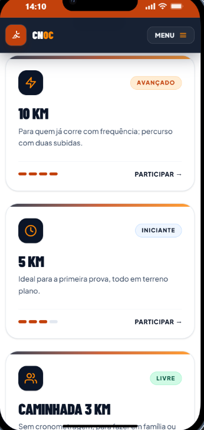
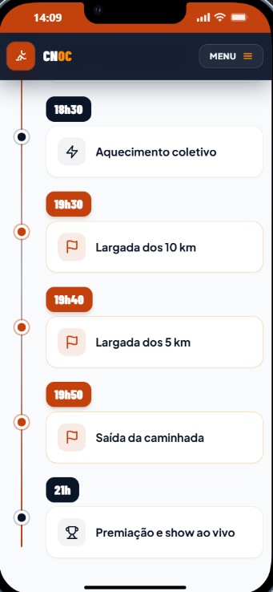
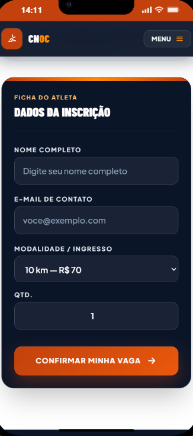
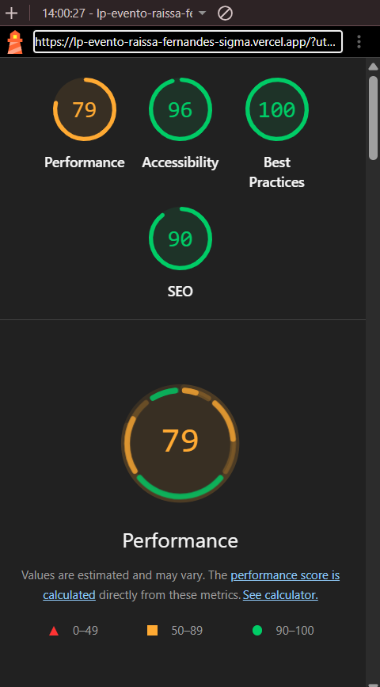
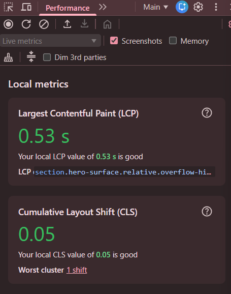

# 🏃 Corrida Noturna OC

Site oficial de divulgação e inscrição da Corrida Noturna OC.

## 🌙 Sobre o projeto

O projeto tem como objetivo divulgar o evento Corrida Noturna OC, apresentar informações sobre a corrida e permitir que os participantes realizem suas inscrições de maneira simples e intuitiva.

## 📸 Prévia do projeto

## ✨ Funcionalidades

- Apresentação do evento.
- Informações sobre a corrida.
- Programação do evento.
- Percursos de 5 km, 10 km e caminhada.
- Formulário de inscrição.
- Suporte ao atleta.
- Gráfico de inscritos por modalidade.
- Contagem regressiva para o evento.
- Botão de lembrete do evento.
- Layout responsivo para celulares e computadores.

## 🛠️ Tecnologias utilizadas

- React
- JavaScript
- HTML
- Tailwind CSS
- Vercel
- Git e GitHub

## 🌐 Deploy

**Site publicado:**

https://lp-evento-raissa-fernandes-sigma.vercel.app

## 📊 Resultados do Lighthouse

Testes realizados no Google Chrome utilizando o Lighthouse, no modo Mobile.

| Categoria | Nota |
|---|---:|
| Performance | 79/100 |
| Acessibilidade | 96/100 |
| Boas práticas | 100/100 |
| SEO | 90/100 |

, 

## 📱 Responsividade

O site foi desenvolvido para se adaptar a diferentes tamanhos de tela, proporcionando uma boa experiência tanto em computadores quanto em dispositivos móveis.

## 👩‍💻 Desenvolvedora

**Raissa Fernandes**

Projeto desenvolvido como atividade educacional.
